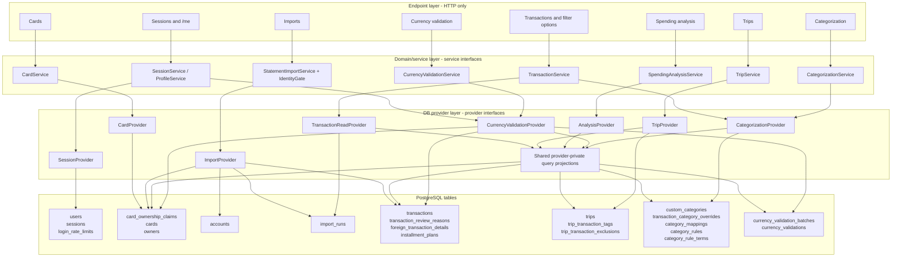

# Phase 1 - API high-level design

**Status: Phase 1 decisions reviewed on 2026-11-01. This consolidated design
awaits final approval; Phase 2 has not started.**

**Extend the existing importer and PostgreSQL persistence rather than replace
them.** The transaction core is reusable; authentication, trips, categorization,
and currency-validation history require new persistence. This document describes
the current V1 architecture and policies, not their decision history.

This document records a plan only. No application code was changed and no
database was contacted.

## Review basis and scope

The API contract and supporting documentation under `docs` were reviewed:

- `api-contract\api-contract.md`
- `api-contract\openapi.yaml`
- `api-contract\screen-to-data-map.md`
- `sequence-diagram.md`
- `implementation-tracking.md`

The existing schema was inspected through checked-in ORM definitions and
migrations, not through a live database:

- `src\bank_transactions\persistence\orm\models.py`
- `src\bank_transactions\persistence\migrations\versions\0001_initial_schema.py`

Existing service, identity, persistence, composition, and dependency conventions
were also inspected.

**Documentation alignment:** the Markdown contract, OpenAPI, and screen map
reflect the approved V1 policies. The reviewed wire-contract gaps are closed;
there is no parallel historical contract.
This document supplies architecture and high-level schema proposals, not
endpoint-by-endpoint implementation specifications.

There is no seeded production database. The target is a fresh database, not an
upgrade of populated production data.

## 1. Contract summary

All paths are relative to `/api/v1`.

| Method | Path | Purpose |
|---|---|---|
| POST | `/sessions` | Sign in; return bearer token and set session cookie |
| DELETE | `/sessions/current` | Revoke current session and clear cookie |
| GET | `/me` | Profile, CSRF token, review counters |
| GET | `/cards` | List caller-owned cards |
| PATCH | `/cards/{cardId}` | Set or clear nickname |
| POST | `/imports` | Synchronous workbook dry run or real import, with identity selections |
| GET | `/imports` | Paginated import history |
| GET | `/transactions` | Filtered, sorted, paginated transactions; optional summary and groups |
| GET | `/transactions/{transactionId}` | Transaction detail, FX, installments, import timestamp |
| PATCH | `/transactions/{transactionId}` | Set or clear category override |
| GET | `/filter-options` | Caller-scoped filter values and counts |
| GET | `/trips` | Trips and summary statistics |
| POST | `/trips` | Create trip |
| GET | `/trips/{tripId}` | Statistics and tagged, automatic, excluded transactions |
| GET | `/trips/{tripId}/candidates` | Find transactions available for tagging |
| PUT | `/trips/{tripId}/tagged-transactions/{transactionId}` | Tag or move transaction; remove target-trip exclusion |
| DELETE | `/trips/{tripId}/tagged-transactions/{transactionId}` | Remove manual tag |
| PUT | `/trips/{tripId}/excluded-transactions/{transactionId}` | Exclude automatic member |
| DELETE | `/trips/{tripId}/excluded-transactions/{transactionId}` | Restore excluded transaction |
| GET | `/spending-analysis` | Totals, comparisons, groups, time series, matrix |
| GET | `/currency-validation-queue` | Progress, country options, manual currency picker catalogue |
| GET | `/currency-validation-queue/items` | Paginated pending or validated transactions |
| POST | `/currency-validation-batches` | Atomic single/bulk/filter-based currency validation |
| DELETE | `/currency-validation-batches/{batchId}` | Undo validation batch |
| DELETE | `/currency-validations/{transactionId}` | Return one validated transaction to pending |
| GET | `/categorization` | Mappings, newest-first rules, match counts, resulting categories |
| POST | `/custom-categories` | Create named custom category |
| PUT | `/category-mappings/{bankCategory}` | Map bank category to custom category |
| DELETE | `/category-mappings/{bankCategory}` | Reset mapping |
| POST | `/category-rules` | Create the newest merchant-text rule |
| DELETE | `/category-rules/{ruleId}` | Delete rule |

**Cross-cutting contract:** authentication everywhere except sign-in;
cookie-authenticated mutations require CSRF; inaccessible resources are
indistinguishable from missing resources (`404`); errors use RFC 9457; money and
rates are decimal strings; only card last-four digits are exposed.

Sharing, stored uploads, generic review actions, trip editing/deletion, and
category-wide reset remain excluded. Automatic currency suggestions, confidence
bands, rule positions, and percentage/purchase/refund reporting are also
excluded by this review. No additional endpoints are proposed.

## 2. Contract versus existing schema

The checked-in schema consists of eight tables and migration `0001`: owners,
accounts, cards, import runs, installment plans, transactions, review reasons,
and foreign details.

| Area | Finding and consequence |
|---|---|
| Authentication | No users, credentials, sessions, ownership claims, or shared login-throttling state exist. Add them using the approved stack and session policy. |
| Public identifiers | Existing exposed entities use integer primary keys. The contract requires opaque identifiers rather than exposing those integers directly. |
| Ownership | Reserve issuer + canonical last-four for one app user. Card creation claims that key; another user receives `409 DATA_ALREADY_OWNED`. Statement-holder names and file hashes do not authorize access. Caller scope must be enforced in provider operations. |
| Owner/account identity scope | Existing owner match keys and bank/account identities are globally unique. Scope metadata discovery and uniqueness to the app user so creating a different claimed card does not expose another user's identity candidates or require reusing their metadata. Exact scope columns and foreign keys belong to Phase 2. |
| Trips | Add trip definitions, manual tags, and exclusions. Reject inclusive date overlaps for the same user, regardless of currency, with `409 TRIP_DATE_OVERLAP`; overlapping-trip allocation is no longer needed. |
| Categorization | Add custom categories, overrides, mappings, rules, and terms. Manual override wins over newest matching rule, then mapping, then bank category. Do not add position-driven priority. |
| Currency validation | Transactions and review reasons support the currency update and queue removal, but validation audit and undo-batch persistence are missing. |
| **Deduplication** | Reference-less matching currently includes `transactions.original_currency`. Validation changes that value; reimporting the original workbook can therefore insert duplicates. Immutable source currency must be preserved for matching. See `src\bank_transactions\persistence\repositories.py:413-440`. |
| **Billing currency** | Existing behavior supports non-ILS billing; see `tests\integration\test_examples.py:10-23`. Preserve native billing currency. All monetary analytics use signed billing values within one currency; never convert or add unlike currencies. |
| **FX presentation** | Preserve imported original amounts and stored signed ratios. Expose API rates as positive magnitudes. No original-sign normalization or corrective backfill is required for billing-based analytics. |
| Import identity | Keep the card-choice/nickname-only wizard. Resolve available evidence; use explicitly unresolved owner/account placeholders where information is missing. Do not fabricate bank identifiers or use holder names as authorization. |
| Import response | Existing `ImportReport` lacks structured identity questions, per-visible-reason counts, and start time. These require richer in-memory service results, not stored row issues. |
| Import filename | Remove `fileName` from API results and history. The original name stays client-side; internal hash-derived audit labels may remain. No original filename/path persistence is needed. |
| Concurrent imports | Add a global same-file in-progress guard and provider-owned card-key serialization. The hash guard coordinates concurrent requests; it does not establish card ownership. |
| Scalar constraints | Use the approved ISO currency catalogue rather than a three-letter pattern alone. Preserve legitimate nullable fields, missing groups, and absent installment plans; do not invent unknown values. |
| Detailed wire definitions | Approved policies, shared billing summaries, the code/name catalogue, billing-currency options, null-key missing groups, and monthly-only average lines are synchronized. The reviewed wire-contract gaps are closed. |

**Already reusable:** encrypted identifiers, card/account ownership constraints,
Decimal precision helpers, nullable FX data, installment persistence, review
reasons, durable import audit, and reference/multiset deduplication.

## 3. Proposed schema changes

These are high-level proposals, not finalized DDL.

| Change | Principal columns, constraints, and indexes |
|---|---|
| `users` | Internal key, public identifier, email, display name, Argon2id password hash, creation timestamp; unique trimmed, case-insensitive login-email key |
| `card_ownership_claims` | User, issuer, encrypted canonical last-four, creation timestamp; globally unique issuer/last-four ownership key; user lookup index |
| `cards` ownership association | Link each card to the matching ownership claim; enforce claim/card-key consistency. Statement `owners` and `accounts` remain metadata, not authorization sources |
| `owners`, `accounts` identity scope | Associate identity metadata with the app user's scope; replace global owner-match and account-identity uniqueness with scoped uniqueness. Preserve card/account owner-consistency foreign keys |
| `sessions` | User foreign key, unique token digest, CSRF binding, creation/expiry and revocation state; absolute 12-hour expiry and user/expiry indexes. Raw bearer tokens are not persisted |
| Login-throttling state | Provider-owned shared counters/window state, for example `login_rate_limits`; keys for normalized email and client IP. State must work across server workers |
| Public IDs | Unique immutable public identifiers on existing `cards`, `transactions`, `import_runs`, and new externally addressed users, trips, rules, and batches |
| `custom_categories` | User, display name, normalized name key, creation timestamp; trimmed case-insensitive per-user uniqueness, nonblank/length constraints, and reserved name `none` |
| `transaction_category_overrides` | User, transaction, custom category; unique user/transaction pair; category references constrained to the same user |
| `category_mappings` | User, raw bank-category name, custom category; unique user/bank-category pair and same-user category reference |
| `category_rules`, `category_rule_terms` | User, category, creation order/time; normalized terms linked to rule; newest matching rule wins and terms are unique within a rule. No position column or position-shifting behavior |
| `trips` | User, public ID, name, currency, start/end dates, creation timestamp; date-order/name constraints and user/date lookup index. Prevent inclusive date overlaps for one user across all currencies |
| `trip_transaction_tags`, `trip_transaction_exclusions` | Transaction/trip links; uniqueness enforcing one manual tag in the approved ownership model; unique trip/transaction exclusions; trip and transaction lookup indexes |
| `currency_validation_batches` | Public ID, creator, creation timestamp, original applied count, and original membership or equivalent undo/invalidation evidence. Retain evidence after a member moves back to pending; support empty batches |
| `currency_validations` | Transaction primary key, approved currency, batch, validating user, timestamp; batch and user/time indexes |
| Immutable source currency | Add nullable `transactions.source_original_currency`; initialize from imported currency and never change during validation or undo. Deduplication uses it while API reads use effective `original_currency` |
| Existing lookup indexes | Add claim/card visibility-path and `transactions.import_run_id` indexes where missing; additional filtering indexes should follow representative query plans |

Keep the existing encrypted identifiers, money/rate precision, review enum,
card/account owner-consistency constraints, and installment uniqueness rules.
The new ownership-key reservation is intentionally stricter across users than
the existing nonunique card lookup. It does not require treating every physical
card with the same last-four as one database row.

**No new tables for** uploads, row issues, currency catalogues, suggestions,
derived category values, automatic trip membership, or analysis totals.
Suggestions are removed entirely. Category and membership changes take effect
without rewriting transaction history.

### Migration approach

Use the existing packaged Alembic directory:

`src\bank_transactions\persistence\migrations\versions\`

The user approved a fresh-database rollout and schema redesign. The initial
schema may be revised rather than preserving a production-upgrade path from
`0001`; select the exact revision layout in Phase 2. There is no legacy
ownership adoption, production data reconciliation, public-ID backfill, or
source-amount sign backfill.

Generate public identifiers and populate immutable source currency when new
rows are imported. Ownership claims, card metadata, plans, and transactions
must remain consistent and atomic. Dry runs roll these changes back; durable
import audit remains separate.

Provide a down migration in Phase 2, dropping dependent objects in reverse
order. Dropping a database populated after rollout is destructive and must be
explicitly identified as such. Keep one canonical migration implementation in
the package and keep ORM definitions consistent with it.

No ILS-conversion schema or live FX-rate dependency is proposed.

## 4. Components and layer boundaries

Follow the repository's package organization:

| Layer | Location and responsibility |
|---|---|
| Endpoint | New `api\` package: routing, HTTP binding, credential extraction, DTO mapping, cookies/headers, status and Problem responses |
| Domain/service | Existing `services\`, `domain\`, `identity\`, and pure ports: validation, card ownership, categorization, trip membership, currency catalogue/validation, analysis rules, orchestration |
| DB provider | Existing `persistence\`: dedicated feature providers owning SQLAlchemy access, query execution, locks, transactions, and persistence-error translation |

Use library-free ABC interfaces at both boundaries, matching existing
conventions. Extend `bootstrap.py` as the composition root; no DI-container
dependency is needed.

The shared projections are implementation helpers **inside persistence**, not a
fourth request layer or a generic repository exposed to services.

Every protected request's HTTP authentication adapter delegates credential
validation to `SessionService`, which calls `SessionProvider`; the adapter never
queries sessions itself.

### Boundary guarantees

- Endpoints depend only on service interfaces and HTTP DTOs.
- Services receive immutable records and typed results, never ORM rows,
  sessions, engines, SQL expressions, or lazy queries.
- Providers enforce caller scope in database operations as defense in depth;
  domain services own the access policy and public outcomes. Scope follows the
  card's ownership claim, not a statement-owner name or an import hash.
- Category precedence and trip ownership rules are domain policies. Provider
  projections implement those policies consistently for filtering, ordering,
  and aggregation.
- `ImportProvider` encapsulates existing repositories and UoW machinery. The
  service retains identity/parsing/deduplication decisions; transaction lifetime,
  commit, rollback, and separate durable audit writes remain provider-owned.

## 5. V1 policies

The following policies apply to the V1 contract. Schema and component choices
that implement them remain high-level proposals until final Phase 1 approval.

### 5.1 Server, credentials, and sessions

**Approved stack: FastAPI + Uvicorn + Argon2id.**

FastAPI is the HTTP framework; Uvicorn is its ASGI server, not the domain layer
or a database abstraction. This fits the existing typed Python services and
keeps HTTP validation/mapping separate from business rules. Flask with a WSGI
server is viable but needs more explicit contract/binding setup. Django/DRF
would introduce a broader framework and overlapping persistence conventions
without a corresponding V1 need.

Argon2id is a memory-hard password hash suited to new password storage. It was
chosen over bcrypt's older password/input constraints and over adopting a
PBKDF2-specific compliance strategy that this project has not required.
Scrypt is also a viable memory-hard alternative; Argon2id is the approved
choice. The Python implementation and benchmarked parameters remain Phase 2
technical decisions, not permission to install a package now.

| Policy | Accepted behavior |
|---|---|
| Provisioning | Administrative user/password provisioning; no self-service registration endpoint |
| Email and password | Trim email and match it case-insensitively; preserve passwords exactly |
| Session | Absolute 12-hour expiry, no sliding extension; opaque tokens stored only as digests; revocation on logout |
| Cookie | `HttpOnly; Secure; SameSite=Lax` |
| Credential precedence | Bearer wins over cookie. An invalid bearer returns `401`; do not fall back to the cookie |
| CSRF | Required for cookie-only mutations. Missing/invalid CSRF returns `403 CSRF_VALIDATION_FAILED`; missing/invalid authentication returns `401` |
| Login throttling | After 10 failed sign-ins in 15 minutes, throttle independently by normalized email and client IP with `429`; no permanent account lockout. State must work across workers |

The existing database and workbook-reader code is synchronous. ASGI does not
make it nonblocking or CPU-parallel automatically. Keep blocking operations off
the event loop with bounded concurrency; do not undertake an unrelated async
database rewrite.

### 5.2 Card ownership and identity

- The app user who creates a card claims its issuer + canonical last-four key.
  Store the last-four encrypted using existing identifier conventions.
- The key is globally reserved for one user. Another user's dry run or real
  import is rejected with `409 DATA_ALREADY_OWNED`, without other-user details.
- This is deliberately a V1 ownership policy, not proof of real-world card
  possession. The user accepts rejecting genuinely different cards that share
  issuer and last-four. A file hash does not determine ownership.
- The import service decides identity and ownership through the provider.
  Parsers supply statement evidence; they never authorize access.
- Preserve caller isolation. Uploads never transfer another user's cards,
  transactions, or history. Statement-holder names are metadata only.
- Keep the nickname-only/card-choice wizard. Use reliable file evidence where
  possible and explicitly unresolved owner/account placeholders otherwise;
  never invent bank/account identifiers.
- Remove `Card.owner.email` from the API. App-user email remains in login and
  profile responses. There is no legacy ownership-adoption workflow.

### 5.3 Imports and history

| Policy | Accepted behavior |
|---|---|
| Upload | XLSX maximum 20 MiB; synchronous processing; no stored uploads |
| Same-file concurrency | Global same-file guard; return `409 IMPORT_IN_PROGRESS` for an active duplicate |
| Overlapping statements | Provider-owned card/key serialization must also protect multiset deduplication across different files |
| Unknown statement format | Recognized XLSX with no supported bank format returns `422 UNKNOWN_STATEMENT_FORMAT`; retain an internal FAILED audit |
| Dry run / NEEDS_INPUT | Audit may be durable, but no owners, accounts, cards, claims, plans, or transactions are committed |
| Filename | Remove `fileName` from results/history; retain the selected name only client-side. Safe internal hash labels may remain |
| History | Include only runs with inserted transactions visible to the caller. Exclude dry runs, all-duplicate runs, FAILED, and NEEDS_INPUT; no uploader column is needed to broaden visibility |
| UI diagnostics | Enrich in-memory results with identity questions, visible review counts, and start time; do not persist row issues |

### 5.4 Currency and FX

- Preserve native billing currencies. Lists contain all billing currencies
  unless filtered; summaries separate their units.
- Require explicit `billingCurrency` for spending analysis and
  `minAmount`/`maxAmount`. The existing `currency` filter means original/purchase
  currency, not billing currency.
- `/filter-options` returns `billingCurrencies` code/count entries for known
  billing currencies present in the caller's whole transaction dataset, plus
  `unknownBillingCurrencyCount`. Original-currency options/counts stay separate;
  missing billing units are never defaulted to ILS.
- Currency review resolves missing original currency on foreign transactions
  only. `currency=UNKNOWN` and unknown-original counts exclude domestic rows
  with `original=null`. Missing billing currency is outside this review and
  cannot contribute to a known-currency sum.
- Remove automatic suggestions, suggestion groups, confidence fields/filters,
  rate bands, and `useSuggestion`.
- Users manually select a currency from **pycountry's bundled ISO 4217
  catalogue**, allowing every entry except `XXX` and `XTS`. Use the same
  catalogue for backend membership validation. Code/name search and
  autocomplete run locally over queue `currencyOptions` entries shaped as
  `{code, name}`; names come from the bundled catalogue. No new endpoint,
  per-keystroke request, or currency table is needed.
- Preserve source original amounts and stored signed rates. API FX and implied
  rates are positive magnitudes; do not normalize source-money signs.
- Populate immutable `source_original_currency` on new imports. Validation and
  undo change effective currency only, leaving source-row deduplication stable.

### 5.5 Validation batches and undo

| Policy | Accepted behavior |
|---|---|
| Selection | Exactly one target: explicit IDs or filter, with an explicitly selected currency |
| Duplicate IDs | Deduplicate and validate each distinct row once |
| Unavailable explicit ID | Whole batch fails with generic `404`, whether missing or inaccessible |
| Already validated row | Whole batch fails with `409 ALREADY_VALIDATED` |
| Filter target | Every matching pending transaction, not only the displayed page |
| Empty filter | Create a `201` empty batch with `validatedCount=0` and `transactionIds=[]` |
| Size / atomicity | No transaction-count business cap, truncation, or separately committed sub-batches; the entire operation is all-or-nothing |
| Undo invalidation | Only later currency/validation-state changes invalidate undo. Category or trip edits do not |
| Undo conflict | If any original member changed currency state, reject the entire undo with `409` and change nothing |
| Undo evidence | Retain original membership/count or equivalent evidence even after a single member moves back to pending |
| State retries | Visible existing resources already satisfying undo/move-back/exclude/restore return `204`; missing/inaccessible resources return `404` |

Internal query chunking, if needed, must stay within the same provider-owned
transaction and must not change the unlimited, atomic API behavior. Lock
duration, memory use, response size, and operational failure handling need an
honest detailed treatment in Phase 2.

### 5.6 Categorization

**Precedence: BANK -> MAPPING -> newest matching RULE -> manual OVERRIDE.
Later layers win.**

Rules match ANY normalized term as a case-insensitive merchant substring, not
regex and not notes. Custom-category names are trimmed and case-insensitively
unique per user while preserving display case; reserve `none`.
`customCategory=none` means no effective custom category from an override, rule,
or mapping.

Remove rule position input/output and position-driven priority. Expose only
merchant match count per rule; remove `changed`, `keptByOverride`, and `shadowed`.
Delete Undo recreates the rule as new, making it newest; it does not restore
the original priority.

### 5.7 Trips

Same-user trips cannot overlap on any inclusive calendar date, regardless of
currency. Jan 1-5 and Jan 5-10 overlap; Jan 1-5 and Jan 6-10 do not. Other users'
trips do not affect creation. Reject overlaps with `409 TRIP_DATE_OVERLAP`.

Keep automatic membership, manual tagging/moving, and out-of-range manual
tags. A manual tag wins over automatic membership; removing it recalculates
automatic membership. Exclusion/restore retries follow the `204`/`404` policy
above. No trip edit/delete endpoints or overlapping-trip fallback policy are
added.

### 5.8 Signed billing-only analytics

**All monetary analytics use signed billing amounts and billing currency.**
Positive, negative, and zero transactions are ordinary rows, not separately
classified purchases and refunds.

| Measure or boundary | Accepted behavior |
|---|---|
| Total | Sum of signed billing amounts within one billing currency |
| Count | Count every selected row, including negative and zero amounts |
| Multi-currency summaries | `BillingSummary` contains all-row `count`, `unknownBillingCurrencyCount`, and `billingTotals` entries with per-currency `count` and `net` Money. Empty sets use an empty array; retain zero-net currencies with rows. Unknown billing units never enter monetary sums |
| Removed analytics | Per-transaction, daily, weekly, and yearly averages everywhere, gross/refund totals, purchase/refund counts, purchase-only averages, percentage shares, and original-currency spending aggregates |
| Monthly average | Signed billed totals in active complete calendar months / number of those months; exclude incomplete and transaction-free months |
| Chart average line | Monthly buckets only, null when undefined. Day/week/year current and comparison averages are always null; keep signed bucket totals and comparison series. The monthly-average stat is independent of chart bucket |
| Empty time buckets | Show zero-valued buckets throughout the requested period, even though inactive months do not enter the monthly average |
| Missing groups | Use `key: null` for missing category/custom-category/country in groups and matrix rows, with fallback labels `Uncategorized` / `No custom category` / `Unknown country`. Trip category groups use `category: null`, `label: "Uncategorized"`. Clients may localize; retain all counts and signed totals |
| Previous comparison | Same number of inclusive days immediately preceding the selected range |
| Year-over-year | February 29 maps to February 28 in a non-leap year |
| Calendar | Weeks start Monday; "today" and month completeness use UTC |
| Default bucket | `month` |

Original amounts remain unchanged in transaction details. Original currency
still supports filtering, trip matching, and FX details; it is not a second
spending-analytics source.

Removed statistic fields and monthly-only chart averages are synchronized in
OpenAPI. Shared billing-summary envelopes, the code/name catalogue,
billing-picker metadata, and null-key missing groups are defined.
Signed-data chart presentation remains detailed UI work. Do not introduce
absolute-value or purchase-only spending to support a positive-only chart.

## 6. Key trade-offs and remaining technical work

| Design choice | Trade-off |
|---|---|
| Reuse the existing importer, parsers, money types, and repositories | Preserves established behavior; requires targeted provider/interface extensions rather than a second importer |
| Card-key claims | Simple exclusive ownership and clear conflicts; issuer/last-four collisions deliberately reject some genuinely different cards |
| User-scoped identity metadata | Prevents cross-user candidate discovery and implicit metadata reuse; may duplicate statement-holder/account metadata across users |
| Database-backed opaque sessions and throttle state | Reuses PostgreSQL and supports immediate revocation/multiworker enforcement; adds authentication reads and cleanup |
| Persistent public IDs alongside integer keys | Preserves internal relationships while hiding implementation identifiers; fresh rows receive public IDs at creation |
| Derived categories and automatic trip membership | Avoids stale stored projections after rules, tags, or currency changes; makes provider read queries more complex |
| Shared caller-scoped projections | Keeps lists, details, filters, and monetary aggregates consistent without loading full datasets into services |
| Provider-owned atomic mutations | Prevents partial validation, undo, and tag moves; unlimited batches can hold locks and consume substantial resources |
| Provider-owned import coordination | Same-file and card-key guards protect separate concurrency hazards; all relevant import writers must use them |
| Nonoverlapping trips | Removes ambiguous automatic allocation; concurrent creation needs a provider-owned per-user serialization guard |
| Request-lifetime workbook input | Honors no stored uploads; adapt the existing reader's input boundary rather than retain server files |
| Explicit HTTP error translation | Preserve intended `400` versus `422` and sanitized Problem responses, rather than relying on framework defaults |
| Billing-only signed analytics | Avoids currency mixing and unreliable original-sign interpretation; older purchase/refund/share charts require contract/UI reconciliation |

**Dependencies:** FastAPI, Uvicorn, Argon2id password hashing, and pycountry
were approved for planning. No dependencies are installed by this task.
The concrete Argon2id package/parameters remain to be selected and flagged.
Existing ABC wiring, SQLAlchemy, Alembic, cryptography, and Decimal remain in
use; no DI library, live FX service, or new database extension is assumed.

**V1 policies are recorded in the current contract.** Remaining work is the
detailed plan, not a decision-history document:

- Carry the approved wire shapes and policies into the detailed plan without
  reintroducing removed features.
- Specify exact public-ID layout, identity-scope/claim foreign keys,
  deterministic newest-rule ordering, indexes, and transactional guards.
- Select password-hashing implementation/parameters and detailed shared
  throttle storage/cleanup, without changing the approved policies.
- Specify provider locks/isolation, unlimited batch handling, and complete undo
  evidence; flag any additional dependency or database extension before use.
- Produce fresh-schema DDL, Alembic up/down scripts, implementation order, and
  domain/provider/endpoint test plans.

## Approval gate

**Phase 1 stops here. Phase 2 remains gated on explicit user approval.**

After approval, Phase 2 will provide the endpoint-by-endpoint DTOs, service and
provider interfaces, validation and error mapping, exact DDL and migrations
(including rollback; no legacy backfill is needed), implementation dependencies,
and test plan.
None of those detailed deliverables or implementation work is authorized by
saving this review document.
