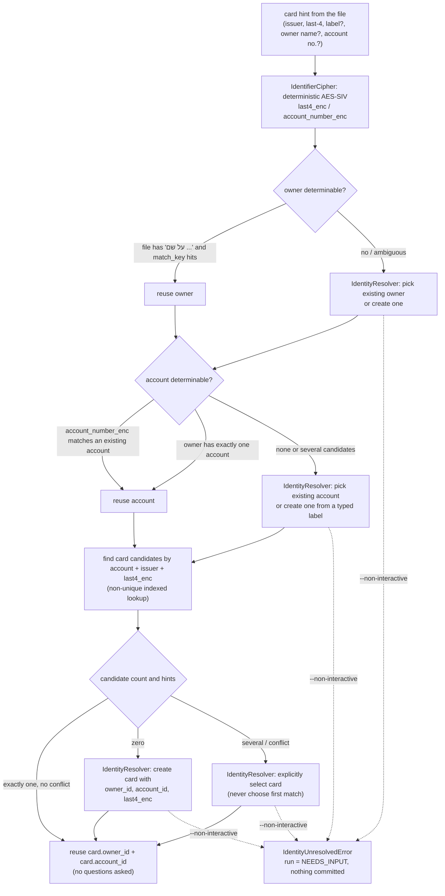
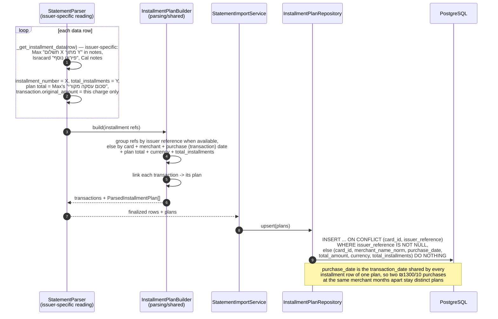
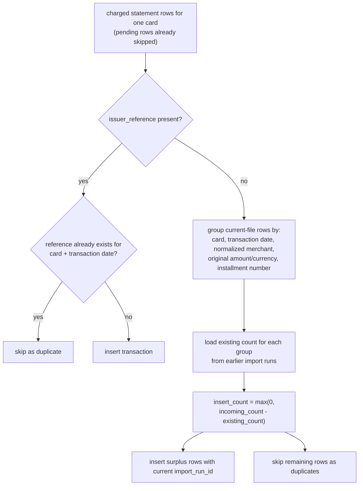
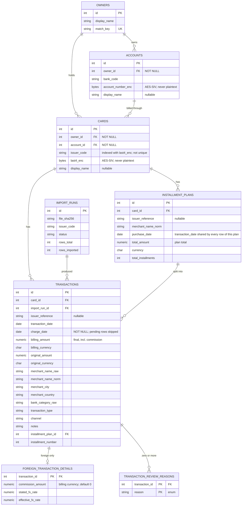

# Sequence & Structure Diagrams — `bank_transactions`

> Diagrams of the implemented importer. Companion to [importer-design.md](importer-design.md), which holds the written design and behavior rules.

## 1. Main import sequence

```mermaid
sequenceDiagram
    autonumber
    actor User
    participant CLI as cli.py
    participant SVC as StatementImportService
    participant RUNREPO as ImportRunRepository
    participant RDR as ExcelWorkbookReader
    participant REG as ParserRegistry
    participant P as StatementParser<br/>(Isracard / Max / CalVisa)
    participant HL as HeaderLocator + ColumnMap
    participant NRM as Normalizers<br/>(Date / Amount / Currency / Text)
    participant SH as parsing/shared<br/>(FeeFolder / PlanBuilder / RateCalc)
    participant CIP as IdentifierCipher
    participant RES as IdentityResolver<br/>(CLI today, UI later)
    participant MAP as TransactionMapper
    participant UOW as UnitOfWork
    participant REPO as Repositories
    participant DB as PostgreSQL

    User->>CLI: bank-transactions import file.xlsx [--non-interactive]
    CLI->>SVC: import_file(path)

    SVC->>SVC: sha256(file)
    SVC->>RUNREPO: start_run(path, sha256)
    RUNREPO->>DB: INSERT import_runs (status = RUNNING)
    RUNREPO-->>SVC: import_run_id
    Note over RUNREPO,DB: import_runs is committed audit data;<br/>it exists before any domain write and survives failures
    Note over SVC: everything below is wrapped in one try/except:<br/>any exception not already terminal calls<br/>finish_run(FAILED, ...) before re-raising, so RUNNING<br/>always reaches a terminal status

    SVC->>RDR: open(path)
    RDR-->>SVC: WorkbookView

    SVC->>REG: select_parser(WorkbookView)
    loop each registered parser
        REG->>P: sniff(WorkbookView)
        P-->>REG: confidence 0.0 - 1.0
    end
    alt nothing above threshold
        REG-->>SVC: None
        SVC->>RUNREPO: finish_run(FAILED, UnknownFormatError)
        SVC-->>CLI: raise UnknownFormatError
    else parser selected
        REG-->>SVC: parser
    end

    rect rgb(235,245,255)
    Note over SVC,P: Step 1 — context only. No transaction rows are read yet.
    SVC->>P: read_context(WorkbookView)
    P->>HL: locate_header(sheet, column_aliases)
    HL-->>P: ColumnMap
    P->>P: _get_owner_data() — banner "על שם ..." / none
    P->>P: _get_account_data() — sheet name / none
    P->>P: _get_card_data() — one CardHint per last-4<br/>(Max files carry several)
    P->>P: period, statement charge date, declared totals
    alt missing sheet, header or required column
        P-->>SVC: raise ParseError
        SVC->>RUNREPO: finish_run(FAILED, ParseError)
        SVC-->>CLI: raise ParseError
    else context read
        P-->>SVC: StatementContext
    end
    end

    rect rgb(245,245,220)
    Note over SVC,RES: Step 2 — identity gate. Runs BEFORE transaction rows are parsed<br/>or written. Issuer + last-4 is search evidence, not a unique identity.
    loop each CardHint in the context
        SVC->>CIP: encrypt(card-last4, last4)<br/>encrypt(account-number, account no.) when present
        CIP-->>SVC: last4_enc + account_number_enc?
        SVC->>REPO: resolve owner/account hints
        REPO->>DB: SELECT owners / accounts
        SVC->>REPO: find_card_candidates(account_id?, owner_id?,<br/>issuer_code, last4_enc)
        REPO->>DB: SELECT zero, one or several cards
        alt exactly one candidate and no conflicting hints
            DB-->>SVC: card (+ owner, account) — nothing is asked
        else zero, several or conflicting candidates
            SVC->>RES: complete(hints, candidates)
            alt interactive (CLI)
                RES->>User: pick / create owner (suggestion from file)
                RES->>User: choose account (matched by account_number_enc,<br/>reused if the owner has exactly one,<br/>else created from a typed label)
                RES->>User: select a matching card or create a new one
                User-->>RES: answers
                RES-->>SVC: ResolvedCardIdentity
                SVC->>UOW: persist identity changes atomically
                UOW->>DB: INSERT owner / account / card as needed
                UOW-->>SVC: card_id
            else --non-interactive
                RES-->>SVC: raise IdentityUnresolvedError
                SVC->>RUNREPO: finish_run(NEEDS_INPUT, unresolved cards)
                SVC-->>CLI: ImportReport(NEEDS_INPUT,<br/>no identity or transaction changes)
            end
        end
    end
    SVC->>SVC: build immutable ResolvedCards<br/>(CardHintKey → CardId)
    end

    rect rgb(240,255,240)
    Note over SVC,SH: Step 3 — rows. Issuer-specific reading inside the parser,<br/>issuer-agnostic algorithms borrowed from parsing/shared.
    SVC->>P: read_transactions(WorkbookView, StatementContext)
    loop each data row (all sheets)
        P->>NRM: normalize date / amount / currency / merchant
        alt malformed transaction row
            P->>P: record error RowIssue with source location; skip row
        else pending row
            P->>P: record informational PENDING_TRANSACTION issue; skip row
        else charged row
            NRM-->>P: normalized values
            P->>P: _get_installment_data(row) — "תשלום 4 מתוך 10",<br/>"פירוט נוסף", plan total vs. per-charge amount
            P->>P: _get_foreign_data(row) — foreign sheet, printed rate,<br/>"עמלת מט"ח" fee marker
            P->>P: read issuer_reference when available
            P->>P: build ParsedTransaction (+ CardHint key)
        end
    end
    P->>SH: finalize(rows, context)
    SH->>SH: ForeignFeeFolder — fold fee markers into their parent
    SH->>SH: InstallmentPlanBuilder — group refs into plans
    SH->>SH: EffectiveRateCalculator — billing_amount / original_amount
    SH-->>P: finalized rows
    alt missing sheet or required column discovered mid-read
        P-->>SVC: raise ParseError
        SVC->>RUNREPO: finish_run(FAILED, ParseError)
        SVC-->>CLI: raise ParseError
    else rows parsed
        P-->>SVC: StatementParseResult<br/>(transactions, issues, rows_seen, calculated_totals)
    end
    end

    SVC->>SVC: retain all RowIssues and continue with valid rows;<br/>error issues make the final run PARTIAL
    SVC->>SVC: compare StatementContext.declared_totals<br/>with parse_result.calculated_totals (per-currency self-check,<br/>never tied to a transaction; no strict abort)

    SVC->>UOW: begin()
    SVC->>REPO: upsert_installment_plans(...)
    REPO->>DB: INSERT ... ON CONFLICT (card_id, issuer_reference)<br/>WHERE issuer_reference IS NOT NULL,<br/>else (card_id, merchant_name_norm, purchase_date,<br/>total_amount, currency, total_installments) DO NOTHING
    DB-->>REPO: resolved installment plan IDs
    REPO-->>SVC: resolved installment plan IDs
    SVC->>MAP: build comparison keys from ParsedTransactions<br/>+ ResolvedCards (no mutation)
    MAP-->>SVC: comparison keys
    SVC->>REPO: find known issuer references
    REPO->>DB: SELECT by card + date + issuer_reference
    SVC->>REPO: count existing reference-less comparison groups
    REPO->>DB: SELECT counts by card + date + merchant<br/>+ original amount/currency + installment number
    SVC->>MAP: map selected ParsedTransactions + ResolvedCards<br/>+ import_run_id + installment plan IDs
    MAP-->>SVC: NewTransactionAggregate[]
    SVC->>REPO: insert_many(aggregates)
    REPO->>DB: INSERT transactions + review reasons + foreign details
    alt commit fails or any unexpected exception
        SVC->>UOW: rollback() (automatic on exception exit)
        UOW->>DB: ROLLBACK domain transaction
        SVC->>RUNREPO: finish_run(FAILED, sanitized error)
        RUNREPO->>DB: UPDATE import_runs
        SVC-->>CLI: re-raise
    else commit succeeds
        SVC->>UOW: commit()
        SVC->>RUNREPO: finish_run(SUCCESS | PARTIAL, counts, issues,<br/>totals-mismatch note appended to error_summary if any)
        RUNREPO->>DB: UPDATE import_runs
        SVC-->>CLI: ImportReport
        CLI-->>User: imported / duplicate / skipped / needs-review / warnings<br/>(totals-mismatch warning included when present)
    end
```

Note: each `import` invocation first sweeps `import_runs` rows stuck in `RUNNING` with no update for over an hour and marks them `FAILED` with an "interrupted" note — the one failure mode (a hard process kill between `start_run` and `finish_run`) that no in-process try/except can catch.

## 2. Identity resolution (owner → account → card)



## 3. Foreign transaction: commission & effective rate

```mermaid
sequenceDiagram
    autonumber
    participant P as StatementParser.finalize<br/>(issuer-specific detection)
    participant FF as ForeignFeeFolder<br/>(parsing/shared)
    participant FX as EffectiveRateCalculator<br/>(parsing/shared)
    participant T as ParsedTransaction
    participant D as ParsedFxDetail

    Note over P: _get_foreign_data(row) already marked which rows are<br/>fee rows and read the printed rate — that wording<br/>(עמלת מט"ח, עמלה ...) is issuer knowledge.
    P->>FF: fold_fees(rows, fee_candidates, date_window)
    loop each fee candidate
        FF->>FF: find nearest unmatched foreign txn,<br/>same card, within date window
        alt parent found
            FF->>T: create updated copy with commission added<br/>to final billing_amount
            FF->>FF: discard the fee row<br/>(never persisted as a transaction)
        else no parent
            FF->>T: keep as an ordinary transaction,<br/>+ review reason UNMATCHED_FOREIGN_FEE
        end
    end
    FF-->>P: transactions with commissions folded in

    P->>FX: compute(transaction)
    alt foreign transaction
        FX->>T: billing_amount = converted + commission
        FX->>D: commission_amount<br/>(always in billing_currency; 0 when no fee)
        FX->>D: stated_fx_rate (from file, may be NULL)
        FX->>FX: require non-zero original_amount,<br/>billing_amount and billing_currency
        FX->>FX: effective = billing_amount / original_amount
        FX->>D: effective_fx_rate
        Note over T,D: transactions keeps the final billed amount and<br/>original amount/currency; the detail row adds<br/>commission and stated/effective rates
    else domestic
        FX-->>P: no FX detail row
    end
    FX-->>P: (ParsedTransaction, ParsedFxDetail?)
```

## 4. Installments



## 5. Deduplication



- All identical rows within the first imported file are inserted because the importer compares the whole incoming group with the database count before inserting.
- A later overlapping file inserts only rows beyond the count already stored. Existing transactions and their original `import_run_id` are never changed.
- Comparisons of nullable original amounts and currencies use NULL-safe equality.

## 6. Entity–relationship model



Derived, never stored: `is_foreign` (an FX detail row exists), `is_refund` (`billing_amount < 0`), `needs_review` (a `TRANSACTION_REVIEW_REASONS` row exists), converted amount excluding commission (`billing_amount - commission_amount`).

## 7. Component / class structure

```mermaid
classDiagram
    class StatementImportService {
        +import_file(path) ImportReport
    }
    class WorkbookReader {
        <<interface>>
        +open(path) WorkbookView
    }
    class ParserSelector {
        <<interface>>
        +select(WorkbookView) StatementParser
    }
    class IdentifierProtector {
        <<interface>>
        +encrypt(value) bytes
        +decrypt(token) str
    }
    class ParserRegistry {
        +register(parser)
        +select(WorkbookView) StatementParser
    }
    class StatementParser {
        <<interface>>
        +issuer_code
        +sniff(WorkbookView) float
        +read_context(WorkbookView) StatementContext
        +read_transactions(WorkbookView, ctx) StatementParseResult
    }
    class StatementParseResult {
        +transactions ParsedTransaction[]
        +issues RowIssue[]
        +rows_seen int
        +calculated_totals StatementTotals
    }
    class ResolvedCards {
        +card_id_for(CardHintKey) CardId
    }
    class TransactionMapper {
        +comparison_key(parsed, card_id)
        +to_new_aggregate(parsed, card_id, import_run_id, plan_id)
    }
    class NewTransactionAggregate
    class TabularStatementParser {
        <<abstract>>
        #column_specs()
        #build_transaction(row, ctx)
        #finalize(rows, ctx)
        #_get_owner_data(workbook)
        #_get_account_data(workbook)
        #_get_card_data(workbook)
        #_get_installment_data(row)
        #_get_foreign_data(row)
    }
    class IsracardParser
    class MaxParser
    class CalVisaParser

    class ExcelWorkbookReader
    class HeaderLocator
    class DateNormalizer
    class AmountNormalizer
    class CurrencyResolver
    class MerchantTextNormalizer

    class ForeignFeeFolder
    class EffectiveRateCalculator
    class InstallmentPlanBuilder

    class IdentifierCipher {
        +encrypt(value) bytes
        +decrypt(token) str
    }
    class IdentityResolver {
        <<interface>>
        +complete(hint) ResolvedCardIdentity
    }
    class CliIdentityResolver
    class NonInteractiveResolver

    class UnitOfWork {
        <<interface>>
        +commit()
        +rollback()
    }
    class TransactionRepository {
        <<interface>>
        +find_known_references(txns)
        +count_matching_groups(keys)
        +insert_many(NewTransactionAggregate[])
    }
    class CardRepository {
        <<interface>>
        +find_candidates(account_id, owner_id, issuer_code, last4_enc)
        +create(owner_id, account_id, ...)
    }

    StatementImportService --> WorkbookReader
    StatementImportService --> ParserSelector
    StatementImportService --> IdentifierProtector
    StatementImportService --> IdentityResolver
    StatementImportService --> ResolvedCards
    StatementImportService --> TransactionMapper
    StatementImportService --> UnitOfWork
    ParserSelector <|.. ParserRegistry
    WorkbookReader <|.. ExcelWorkbookReader
    IdentifierProtector <|.. IdentifierCipher
    ParserRegistry o-- StatementParser
    StatementParser --> StatementParseResult
    TransactionMapper --> NewTransactionAggregate
    TransactionRepository --> NewTransactionAggregate
    StatementParser <|.. TabularStatementParser
    TabularStatementParser <|-- IsracardParser
    TabularStatementParser <|-- MaxParser
    TabularStatementParser <|-- CalVisaParser
    TabularStatementParser --> HeaderLocator
    TabularStatementParser --> DateNormalizer
    TabularStatementParser --> AmountNormalizer
    TabularStatementParser --> CurrencyResolver
    TabularStatementParser --> MerchantTextNormalizer
    TabularStatementParser --> ForeignFeeFolder
    TabularStatementParser --> EffectiveRateCalculator
    TabularStatementParser --> InstallmentPlanBuilder
    IdentityResolver <|.. CliIdentityResolver
    IdentityResolver <|.. NonInteractiveResolver
    UnitOfWork o-- TransactionRepository
    UnitOfWork o-- CardRepository
```



Note the direction of the arrows: the **parsers** own the shared algorithms, and only the **import service** touches repositories and the unit of work. No arrow runs from a parser to a repository. `StatementImportService` depends only on the interface classes (`WorkbookReader`, `ParserSelector`, `IdentifierProtector`, `IdentityResolver`, `UnitOfWork`); the concrete adapters (`ExcelWorkbookReader`, `ParserRegistry`, `IdentifierCipher`) each realize their port and are wired in by `bootstrap.py`, which is the only place that references both the abstractions and the concrete adapters together.

